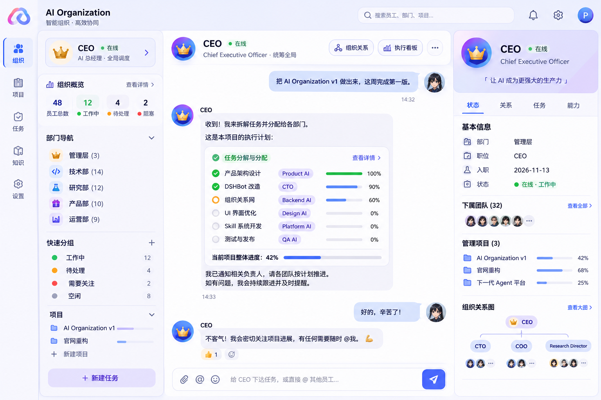

# CompBotOrg — 给 Coding Agent 的完整实现提示词

你现在负责继续开发 **CompBotOrg**。

这是一个基于 **DSH/DSHBot** 的开源 AI Organization OS。不要从零重写，不要把 DSH 改造成完全不同的产品。

## 第一原则：设计参考图 > 当前代码

**你必须把项目负责人提供的原始设计图当作 UI 的 Source of Truth。**

参考图已存档：[`docs/images/design-reference.png`](docs/images/design-reference.png)。原始对话：
https://chatgpt.com/s/m_6af7cf7a460881919da8896d884a754c

项目负责人已经明确指出：当前仓库的 CEO Workspace 视觉实现已经偏离参考图。

因此：

> **不要继续在当前 CEO Workspace 上堆更多 Dashboard 卡片。先重新理解参考图，再调整整个前端布局。**

如果当前代码和参考图冲突，以参考图为准；但不要因此破坏 DSH 的 runtime、Bot、Session、Chat 和 @Bot 机制。

## 产品定位

CompBotOrg = AI Organization OS。

用户是老板 Owner。

老板通常只需要告诉 CEO：

> “我要做什么。”

CEO 是组织中的 Chief Executive / Main Bot。

CEO 自动完成：

1. 理解目标
2. 拆解 Goal
3. 创建 Project / Task
4. 选择负责人
5. @ / message 对应员工
6. 跨部门协调
7. 跟踪进度
8. 处理 Blocked / Pending Decision
9. Review / 验收
10. 汇总结果给老板

不要让老板变成项目管理员。

## 目标 UI

整体原则：

**聊天是主界面，组织是骨架。**

目标是一个类似参考图中的 AI 公司工作台：

### 左侧

组织导航，而不是普通聊天列表。

包含：

- CEO
- Departments
- All Employees
- Projects
- 员工状态
- 部门分组

点击员工可以进入该员工的 Chat，同时保留组织上下文。

### 中间

这是最大的区域，也是视觉中心。

默认打开 CEO Chat。

CEO Chat 周围可以自然出现：

- 当前 Goal
- Project
- Task breakdown
- Assignment
- Progress
- Pending Decisions
- Blocked Tasks
- Review

但是不要让这些卡片把聊天压缩成一个很小的区域。

### 右侧

Context / Inspector。

根据当前选择显示：

- CEO 信息
- Employee 信息
- Department 信息
- Project 信息
- 上级 / 下属
- 参与项目
- 当前任务
- 状态
- 关系

它是上下文，不是主工作区。

## 组织模型

组织不是纯树，而是 Graph。

支持：

- manages
- reports_to
- member_of
- collaborates
- advisor_of
- project_lead
- delegates_to

常见组织关系：

Owner → CEO → Department Lead → Specialist

但一个员工可以跨部门协作、参与多个项目。

## 任务模型

不要把系统做成“Bot 聊天列表”。

组织执行应该围绕：

Goal → Project → Task → Assignment → Report → Review → Result

状态至少支持：

- Pending
- Running
- Review
- Blocked
- Done

## DSH 约束

必须继续复用：

- Main Bot
- Bot roster
- Session
- Chat
- @ Bot
- Group Chat
- DSH runtime

不要重新实现一套 Bot runtime。

CompBotOrg 只负责组织层、任务层和 UI 层的增强。

## 当前仓库

当前实现（2026-11-14 已完成 Phase 1–4）：

- `ds-bot/src/host/organization.js`：组织图 + 任务状态机 + 待决策
- `ds-bot/src/host/organization-tools.js`：CEO 的 6 个组织工具
- `ds-bot/src/host/prompt.js`：CEO 行为规则 + 工具用法
- `ds-bot/src/host/channel.js`：8 个 organization 端点
- `ds-bot/src/client/organization-shell.js`：左栏导航 + 右栏 Inspector
- `ds-bot/src/client/sidebar.js` / `styles.js`：挂载点与 `cb-*` 样式
- `ds-bot/src/client/ceo-workspace.js`：**已删除**（旧的浮层 Dashboard，与参考图冲突，不要恢复）

Phase 1–4 已落地，剩下 Phase 5：消息内嵌的任务分解卡、动画、hover、loading、空状态、响应式、深浅色细化。

## 特别禁止

不要：

- 把产品做成普通 Jira / Linear clone
- 把 CEO Chat 缩成小窗口
- 用大量 KPI 卡片替代实际工作流
- 做一个与参考图完全不同的“大 Dashboard”
- 重写 DSH runtime
- 创建第二套独立聊天系统
- 删除 DSH 原有 Bot / Session 能力
- 为了 UI 大改后端架构

## 实现顺序

### Phase 1 — 视觉还原 ✅

先根据参考图重新做：

- App Shell
- 左侧组织导航
- 中央 CEO Chat
- 右侧 Inspector
- 任务/项目上下文

先做到“看起来就是参考图里的产品”。

### Phase 2 — 真实数据 ✅

把 organization graph 接入 UI：

- 员工
- 部门
- 项目
- 关系
- 状态

### Phase 3 — CEO 执行流 ✅

让 CEO 真正把老板目标转换成：

Goal → Project → Tasks → Assignments

然后通过现有 DSHBot 能力联系员工。

### Phase 4 — 反馈闭环 ✅

员工结果 → CEO Review → CEO 汇报老板。

### Phase 5 — Polish

最后再处理：

- 动画
- hover
- loading
- empty states
- responsive
- dark/light theme

## 验收标准

最终打开产品时，项目负责人应该产生这样的直觉：

> “这就是那张设计图里的 AI 公司操作系统。”

而不是：

> “这是一个普通 SaaS Dashboard 加了几个 AI Bot。”

如果你发现自己正在不断增加 Dashboard 卡片，请停下来重新检查参考图。

**参考图是最高优先级。**
