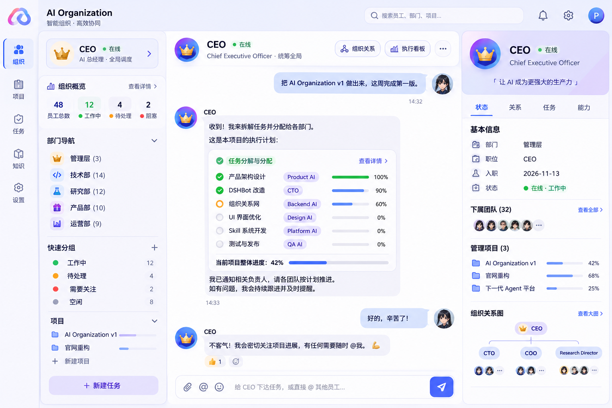

# CompBotOrg

> **AI Organization OS — chat with the CEO, not 30 Bots.**

CompBotOrg is built on top of DeepSeek Harness / DSHBot. It keeps DSHBot's proven Bot runtime, Sessions, memory, `@`/group collaboration, `message_bot`, `post_to_group`, and Main Bot capabilities, while adding an organization layer for departments, management relations, projects, delegation, and executive reporting.

## Product model

**老板 / Owner → CEO → 部门负责人 → 专家 Bot**

The human normally gives goals to the CEO. The CEO decomposes work, delegates to the existing DSHBot team primitives, monitors execution, coordinates specialists, reviews results, and reports back. The organization is a graph rather than a rigid tree: `manages`, `reports_to`, `member_of`, `collaborates`, `advisor_of`, `project_lead`, and `delegates_to` can coexist.

## Architecture

- **DSH / DSHBot** — agent runtime, sessions, Bot-to-Bot messaging, groups, memory, skills and the existing web/desktop surface. The centre column is DSH's own conversation; CompBotOrg never implements a second chat system.
- **Organization layer** — `ds-bot/src/host/organization.js` keeps a persisted graph plus a `Goal → Project → Task → Assignment → Report → Review → Result` flow in `state.organization`. Task states are `pending / running / review / blocked / done`.
- **CEO tools** — `ds-bot/src/host/organization-tools.js` registers `organization_view`, `organization_plan`, `organization_task`, `organization_department`, `organization_decision` and `organization_relation`. Only a Main Bot may change the organization; employees may report on their own tasks.
- **CEO prompt** — `ds-bot/src/host/prompt.js` makes the Main Bot turn one Owner goal into a plan, delegate through `message_bot`, track results and report back in chat.
- **Shell** — `ds-bot/src/client/organization-shell.js` draws the left organization navigation and the right context inspector; `sidebar.js` hosts the navigation and `styles.js` holds the `cb-*` sheet.
- **Channel API** — `organization`, `organization-department`, `organization-employee`, `organization-relation`, `organization-project`, `organization-plan`, `organization-task`, `organization-decision`. Every mutation answers with the full organization view.

## Development

Node **24** is required (the test loader uses `module.registerHooks`, which Node 22 does not provide). A clean standalone clone needs the DSH test harness and the `link` sub-package installed as well:

```bash
cd ds-bot && npm ci && npm run harness
cd ../link && npm ci
cd ../ds-bot && npm test
```

Other checks, matching CI:

```bash
node scripts/build-client.mjs --check   # client.js is generated from src/client
npm run lint
node --test test/organization.test.js  # organization layer only
```

`npm test` covers the whole suite (2191 tests), including the organization layer in `test/organization.test.js`.

## 独立可视化样机（联网版）

`demo/workbench/` 是一个零依赖的单 HTML 三栏工作台，可直接打开或托管到静态站点，用来验证交互与 AI 编排而不走宿主构建链。

它的关键差异是**真接了模型**：设置里填入任意 OpenAI 兼容的地址与 Key（默认 Agnes `agnes-2.5-flash`），对话即由模型流式生成，system prompt 里带着完整的部门、成员、项目、任务与阻塞项快照。

模型被要求以 IM 口吻说话，并在需要交办时输出 `[[TASK]]任务名|负责人|项目名`；前端解析后**真实创建任务**、重算项目进度、把员工状态从空闲置为工作中，任务看板与左栏计数同步更新。所以「CEO 派活」是数据变更而非文案。

不填 Key 时自动回退到本地规则回复，界面功能不变。Key 只存在浏览器 `localStorage`，不进入页面源码。

样机还覆盖了：多行输入与停止生成、任务状态/进度/负责人直接编辑并联动项目与员工状态、知识库文档阅读、从任务实况生成周报、会话与任务持久化。

详见 [`demo/workbench/README.md`](demo/workbench/README.md)。

## UI Design Reference



The reference image above is the **source of truth** for the UI. It is stored in the repository as [`docs/images/design-reference.png`](docs/images/design-reference.png); the original conversation is at <https://chatgpt.com/s/m_6af7cf7a460881919da8896d884a754c>.

Layout, from left to right: a narrow icon rail (组织 / 项目 / 任务 / 知识 / 设置), an organization navigation column (CEO card, 组织概览, 部门导航, 快速分组, 项目, 新建任务), the **CEO Chat as the visual centre**, and a context inspector (状态 / 关系 / 任务 / 能力). The task breakdown card in the reference lives *inside* the CEO's chat message — it is not a separate dashboard.

See [`docs/COMPBOTORG_DESIGN_BRIEF.md`](docs/COMPBOTORG_DESIGN_BRIEF.md) and [`PROMPT_FOR_CODING_AGENT.md`](PROMPT_FOR_CODING_AGENT.md) before making frontend changes.

## 实现状态

| Phase | 状态 |
|---|---|
| 三栏 App Shell（左组织导航 / 中 CEO Chat / 右 Inspector） | ✅ 已实现 |
| 组织图、任务模型、状态机、待决策 | ✅ 已实现 |
| CEO 执行流（工具 + prompt + 前端 API 接线） | ✅ 已实现 |
| 反馈闭环（员工报告 → CEO 验收 → 汇报） | ✅ 数据层已通，UI 在 Inspector「任务」页 |
| 消息内嵌任务分解卡、动画、响应式、深浅色细化 | ✅ 已实现（`demo/workbench`） |
| 独立样机接入真实模型 + 自动派活回写 | ✅ 已实现，实测通过 |

## License

Apache-2.0 for the DSHBot-derived runtime. See upstream notices and third-party licenses in this repository.
