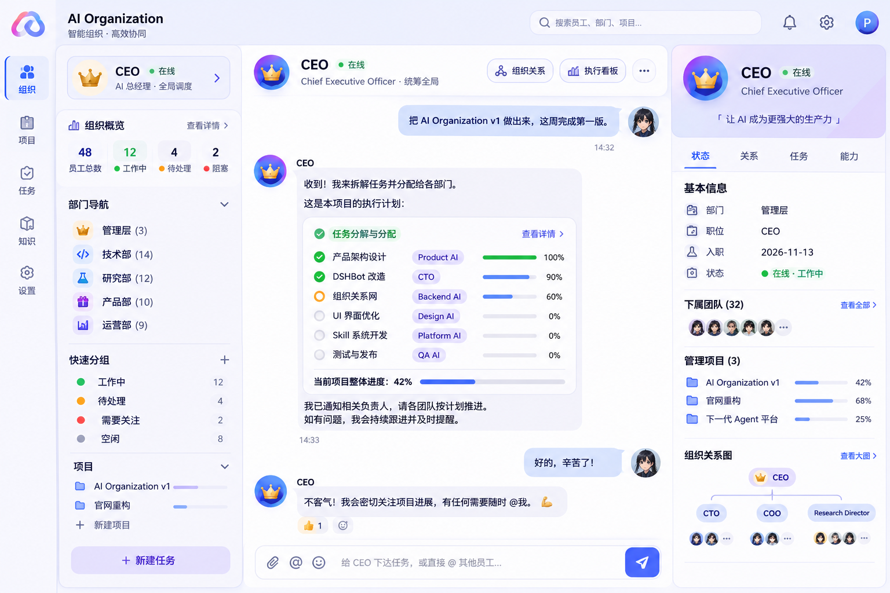

# CompBotOrg UI Design Brief — Reference Is the Source of Truth

> **重要：实现时以设计参考图为最高优先级。不要以当前仓库里的 CEO Workspace 代码作为视觉参考。当前实现只是功能实验，视觉方向可能偏离目标，需要按参考图重新设计。**

## 设计目标

CompBotOrg 是一个建立在 DSH/DSHBot 之上的 AI Organization OS。

核心产品原则：

- **聊天是主界面，组织是骨架。**
- 老板只需要和 CEO 沟通目标。
- CEO 负责拆解目标、委派、协调、跟进、验收、汇报。
- Bot 在产品里不是“工具列表”，而是组织中的“员工”。
- 部门、员工、项目、任务、上下级和协作关系都应该自然地呈现在一个统一工作台里。

## 视觉参考

设计必须严格参考项目负责人提供的原始设计图（即之前讨论中“AI Organization / CEO 指挥中心”的那张图）。

参考图已存档在仓库中：[`docs/images/design-reference.png`](images/design-reference.png)（原始出处：<https://chatgpt.com/s/m_6af7cf7a460881919da8896d884a754c>）。

**注意：旧的 `ceo-workspace.js` 浮层 Dashboard 已被删除，不要恢复它。当前三栏实现以 `organization-shell.js` 为准。**

### 参考图精确拆解

| 区域 | 内容 |
|---|---|
| 顶部栏 | 左「AI Organization / 智能组织 · 高效协同」，中「搜索员工、部门、项目…」，右通知 / 设置 / 头像 |
| 最左窄栏 | 竖排图标：组织（选中，蓝色胶囊）/ 项目 / 任务 / 知识 / 设置 |
| 左栏 | CEO 卡片（皇冠头像、在线、AI 总经理 · 全局调度）→ 组织概览 48 员工总数 / 12 工作中(绿) / 4 待处理(橙) / 2 阻塞(红) → 部门导航 管理层(3)、技术部(14)、研究部(12)、产品部(10)、运营部(9) → 快速分组 工作中 / 待处理 / 需要关注 / 空闲 → 项目（带进度条）→「＋ 新建任务」 |
| 中栏（视觉中心） | 头部 CEO · 在线 / Chief Executive Officer · 统筹全局 +「组织关系」「执行看板」「···」；下方是**原生聊天**：用户气泡「把 AI Organization v1 做出来，这周完成第一版。」、CEO 回复内嵌「任务分解与分配」卡片（任务、Product AI 等标签、进度条、百分比、当前项目整体进度 42%）、后续对话与输入框「给 CEO 下达任务，或直接 @ 其他员工…」 |
| 右栏 | 紫色渐变 CEO 卡片 +「让 AI 成为更强大的生产力」；Tab 状态 / 关系 / 任务 / 能力；基本信息（部门 管理层、职位 CEO、入职 2026-11-13、状态 在线·工作中）；下属团队 (32)；管理项目 (3) 带进度；组织关系图（CEO → CTO / COO / Research Director） |
| 视觉 | 浅色底、白卡、大圆角、细边框、轻阴影；主色蓝紫，状态色绿 / 橙 / 红 / 灰；三栏约 56 + 220 + flex + 250 px |

**最关键的一条**：任务分解卡片是嵌在 CEO 的消息里的，不是浮在聊天上方的独立 Dashboard。聊天必须占据中栏最大面积。

## 核心布局

目标结构是一个真正的组织协同工作台，而不是单独的一张 Dashboard：

1. **左侧：组织导航**
   - CEO
   - 部门
   - 全部员工
   - 项目
   - 可按组织/部门/项目分组
   - 员工在线/工作状态应该一眼可见

2. **中间：主工作区**
   - 默认是 CEO 对话
   - CEO 对话是整个系统的核心入口
   - 对话旁/下方自然出现目标、任务拆解、执行状态、待决策事项等结构化信息
   - 不要把聊天挤成一个小窗口

3. **右侧：上下文/组织详情**
   - 当前 CEO / 员工 / 部门 / 项目详情
   - 职位、上级、下属、负责任务、项目、状态
   - 关系网络
   - 需要时出现，不抢占主聊天空间

4. **组织关系**
   - 老板 → CEO → 部门负责人 → 专家员工是最常见路径
   - 但底层必须支持图关系，而不是只能做树
   - supports: manages / reports_to / member_of / collaborates / advisor_of / project_lead / delegates_to

## 交互原则

- 老板不应该被迫手动创建几十个任务。
- 老板给 CEO 一个自然语言目标即可。
- CEO 应自动形成：Goal → Project → Task → Assignment → Report → Review → Result。
- CEO 可以通过 DSHBot 现有能力 `@` 员工、发消息、使用群聊完成委派和协作。
- 用户点开员工后，应该像打开一个真实员工的工作档案，而不是一个普通 Bot 设置页。
- 用户点开项目后，应看到任务流和参与员工。
- 状态应清晰：Pending / Running / Review / Blocked / Done。

## 视觉要求

- 参考图优先于开发者自己的审美。
- 不要擅自改成“普通 SaaS Dashboard”。
- 不要大量增加 KPI 卡片来替代组织协作信息。
- 不要把 CEO 工作台做成覆盖聊天的大型全屏弹窗。
- 保持聊天区域是视觉中心。
- 信息密度、留白、卡片圆角、字体层级、边框、阴影、颜色和导航比例应尽量贴近参考图。
- 保留 DSH 原有交互习惯，尽量微调，不要重写 DSH。

## 技术约束

- 基于现有 DSH/DSHBot。
- 不做大规模重写。
- 复用现有 Bot、Session、Chat、Main Bot、@Bot、Group Chat 能力。
- CompBotOrg organization layer 是增量能力。
- DSH runtime 仍然是 Bot 执行的 source of truth。
- 不要为了视觉重做后端。

## 当前实现说明

当前实现（2026-11-14）：

- `ds-bot/src/client/ceo-workspace.js`：**已删除**。它是一张盖住聊天的浮层 Dashboard，与参考图冲突。
- `ds-bot/src/client/organization-shell.js`：左栏 `OrganizationNav` + 右栏 `OrganizationInspector`，数据全部来自 `roster.organization`。
- `ds-bot/src/client/sidebar.js`：宽模式下挂载 `OrganizationNav`；rail 模式保留 DS Bot 原生 CEO tile。
- `ds-bot/src/host/organization.js`：组织图 + 任务状态机 + 待决策，`organizationView()` 为纯函数（不写 state）。
- `ds-bot/src/host/organization-tools.js` 与 `prompt.js`：CEO 用工具把目标变成项目/任务/委派，再用 `message_bot` 派人。
- `ds-bot/src/client/styles.js` 的 `cb-*` 段：所有颜色走 `--bt-*` 变量，圆角只用 ui-standard 的阶梯值。

仍待 Polish：消息内嵌的任务分解卡、真实头像照片、动画与移动端细节。

## Definition of Done

完成后必须满足：

- 打开 CEO 时，第一视觉焦点仍然是 CEO Chat。
- 左侧可以理解整个组织。
- 中间可以看到 CEO 如何推动任务执行。
- 右侧可以查看组织上下文。
- 用户不需要学习复杂的项目管理软件。
- UI 看起来应该像参考图，而不是当前代码自己演化出来的另一套 Dashboard。
- 桌面端优先，同时不能破坏 DSH 原有布局。
